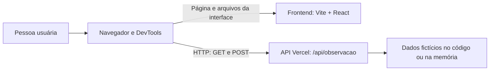
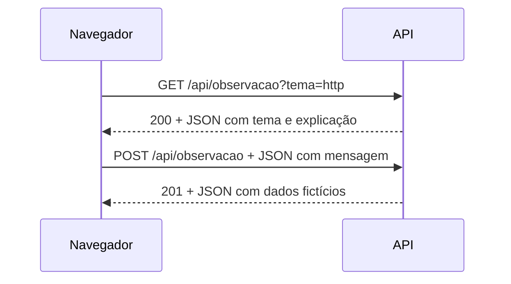

# Laboratório de observação HTTP

Este laboratório apresenta, de forma prática, como um navegador troca mensagens
HTTP com uma API. Os dados são fictícios e ficam apenas no código ou na memória:
não há banco de dados.

## Arquitetura

O navegador recebe a página e executa a interface em React. A interface e a API
são componentes diferentes: a primeira apresenta o conteúdo; a segunda recebe
requisições e devolve respostas JSON.



Arquivos principais:

- `index.html`: entrada HTML da aplicação.
- `src/main.jsx`: inicializa o React.
- `src/App.jsx`: contém a interface.
- `api/observacao.js`: implementa a API JavaScript da Vercel.

## Como executar

É necessário ter o Node.js **20.19 ou superior na série 20**, ou **22.12 ou
superior**, e o npm instalados, conforme os requisitos do Vite. Na Vercel,
configure também uma versão compatível do Node.js para o projeto.

Na raiz do repositório, instale as dependências:

```bash
npm install
```

Para desenvolver e visualizar **somente o frontend**:

```bash
npm run dev
```

Abra o endereço local informado no terminal. O servidor do Vite, sozinho,
**não executa a API**; por isso, requisições para `/api/observacao` precisam do
ambiente da Vercel.

Para executar frontend e API juntos localmente, use a CLI da Vercel na raiz do
projeto:

```bash
npx vercel dev
```

Siga as instruções da CLI para vincular ou configurar o projeto, se solicitado,
e abra o endereço local que ela informar. Como alternativa, use a aplicação
implantada na Vercel.

## Fluxo HTTP

Uma requisição tem método, endereço, cabeçalhos e, quando necessário, corpo.
A resposta tem um status, cabeçalhos e um corpo. Neste laboratório, a API usa
JSON:



- `GET /api/observacao?tema=http`: consulta uma explicação sobre o tema e
  retorna um objeto JSON com o tema e a explicação.
- `POST /api/observacao`: recebe JSON como `{"mensagem":"Olá"}`, valida a
  mensagem e retorna dados fictícios.
- `200 OK`: consulta atendida.
- `201 Created`: envio válido atendido.
- `400 Bad Request`: dados enviados inválidos, como uma mensagem ausente.
- `405 Method Not Allowed`: método não permitido pela API.

O status informa o resultado da requisição; ele não garante que os dados foram
armazenados de forma permanente.

## Observando no DevTools

Use `npx vercel dev` ou abra o projeto implantado. As ferramentas de
desenvolvedor variam entre navegadores; os nomes abaixo são comuns no Chrome e
em navegadores semelhantes.

1. Abra as ferramentas do desenvolvedor com **F12** ou **Ctrl+Shift+I**
   (no macOS, **Cmd+Option+I**).
2. Selecione a aba **Network** (Rede). Ative **Preserve log** se quiser manter
   o histórico ao navegar e filtre por **Fetch/XHR**, se disponível.
3. Na própria página, no formulário **GET · consultar**, selecione **HTTP** em
   **Tema** e clique em **Consultar tema**.
4. Selecione a requisição GET na lista. Em **Headers**, observe a URL, o método
   e o status `200`; em **Response** ou **Preview**, examine o JSON de resposta.
   O valor depois de `?tema=` é um parâmetro da URL.
5. No formulário **POST · enviar**, digite `Olá` em **Mensagem fictícia** e
   clique em **Enviar mensagem**.
6. Na aba **Network**, selecione o POST. Confira o método e o status `201` em
   **Headers**, o JSON enviado em **Payload** e os dados fictícios retornados
   em **Response**. `Content-Type: application/json` indica o formato do corpo
   enviado.
7. Na seção **Exemplos de erro** da página, clique em **Consultar tema inválido**.
   A API responde `400 Bad Request`, pois o valor `desconhecido` não é um tema
   permitido. Depois clique em **Tentar DELETE**: a API responde
   `405 Method Not Allowed`, pois só aceita `GET` e `POST`. Em ambos os casos,
   confira o status e o JSON com a explicação na área **Resposta da API** e na
   aba **Network**.

Opcionalmente, para observar erros da API, execute estes comandos no **Console**
da página e confira cada requisição e resposta em **Network**:

```js
// Tema desconhecido: 400
fetch('/api/observacao?tema=desconhecido');

// Mensagem ausente: 400
fetch('/api/observacao', {
  method: 'POST',
  headers: { 'Content-Type': 'application/json' },
  body: JSON.stringify({})
});

// Método não permitido: 405
fetch('/api/observacao', { method: 'PUT' });
```

O formulário pode impedir o envio de uma mensagem vazia antes de a requisição
chegar à API; por isso, o exemplo opcional envia o JSON inválido diretamente.

Execute no Console apenas comandos que você entende e em páginas confiáveis.
Se a API não responder durante o desenvolvimento, confirme que a página foi
aberta pelo endereço do `vercel dev`, e não apenas pelo servidor do Vite.

## Implantação na Vercel

1. Envie o projeto para um repositório Git acessível pela sua conta Vercel.
2. No painel da Vercel, crie um projeto e escolha a importação do repositório.
3. Selecione **Vite** como framework e mantenha as configurações padrão de
   build e de diretório de saída. Inicie o deploy.
4. Ao concluir, abra a URL fornecida pela Vercel e confira o frontend e
   `/api/observacao?tema=http`. A Vercel serve a aplicação e a função da API na
   mesma origem.

A URL pública da Vercel usa **HTTPS**, que protege o tráfego em trânsito. O
endereço local informado pelas ferramentas pode usar HTTP; ele é destinado ao
desenvolvimento na própria máquina.

## Segurança e limites

- Não envie senhas, tokens, informações pessoais ou quaisquer dados sensíveis:
  use somente exemplos fictícios.
- Não há autenticação, autorização, sessão real ou cookies de sessão. A API
  não verifica a identidade nem permissões de quem a acessa.
- Não há persistência real nem banco de dados. Dados em memória podem
  desaparecer entre requisições, reinicializações ou instâncias da função.
- HTTPS não transforma este laboratório em uma aplicação pronta para produção
  e não substitui controles de acesso, validação adequada ou proteção de dados.
- O DevTools mostra informações disponíveis ao navegador; não trate conteúdo
  visível ali como secreto. Não copie nem compartilhe registros contendo dados
  sensíveis.
