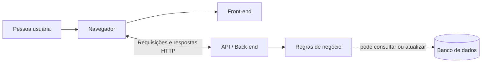
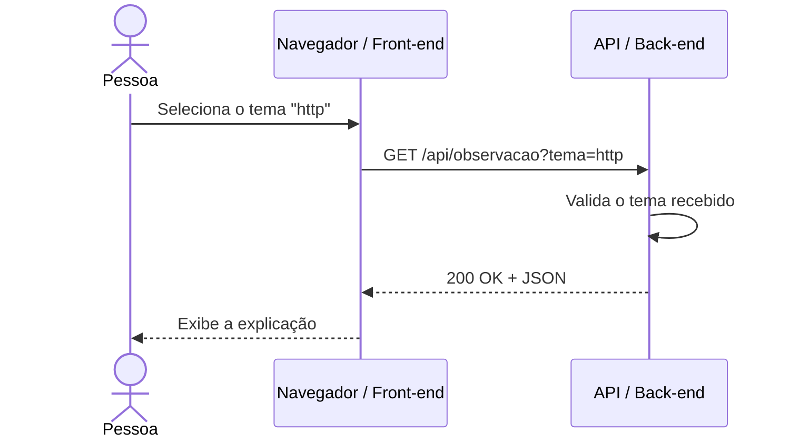
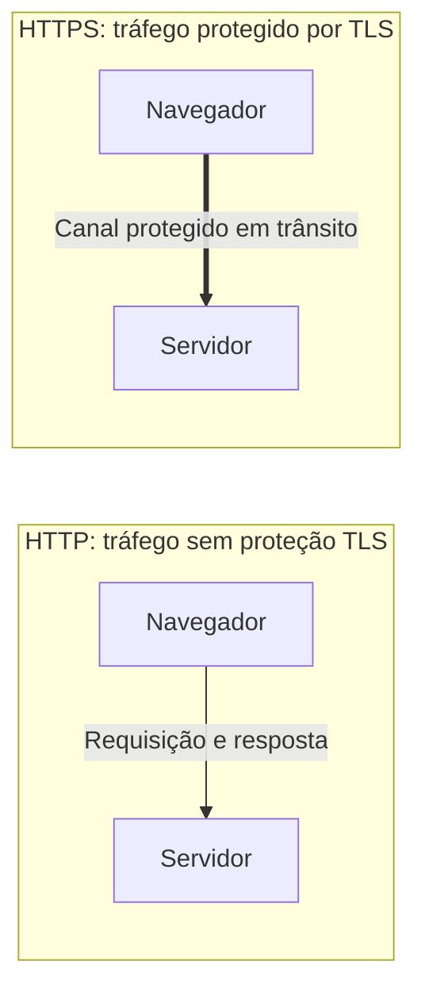
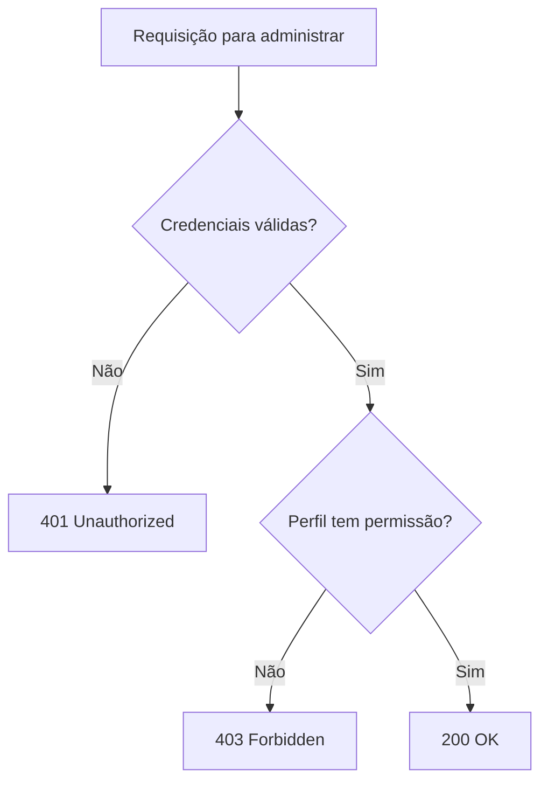
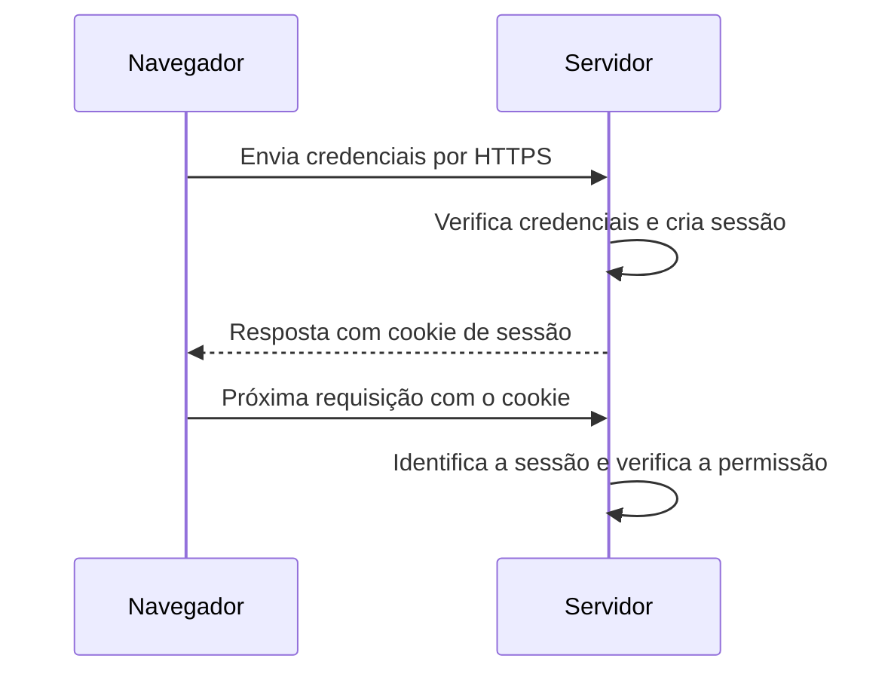
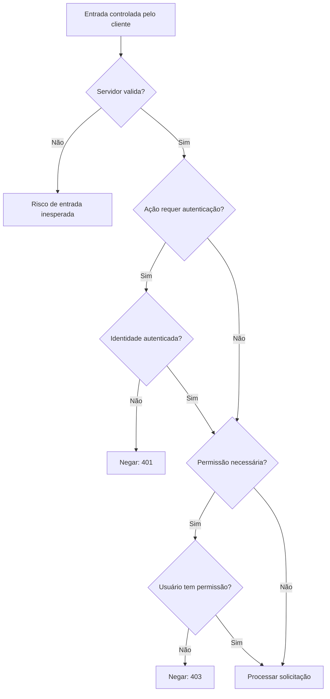
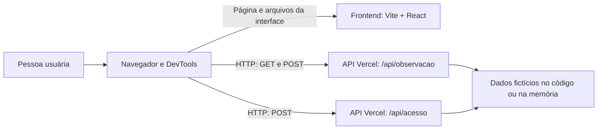
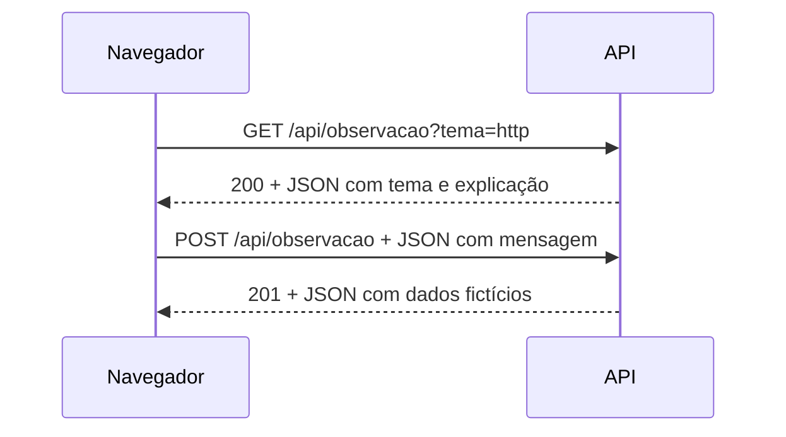

# Laboratório de observação HTTP

Este laboratório apresenta, de forma prática, como um navegador troca mensagens
HTTP com uma API. Os dados são fictícios e ficam apenas no código ou na memória:
não há banco de dados.

## Resumo da aula: fundamentos de aplicações web

Uma aplicação web é formada por componentes que cooperam para apresentar uma
interface, processar regras e, em aplicações completas, armazenar informações.
Entender esse caminho ajuda a localizar onde os dados entram, onde são
validados e quem deve controlar o acesso.

### Cliente, servidor e partes da aplicação

O **cliente** inicia uma solicitação — normalmente, é o navegador. O **servidor**
recebe a solicitação, executa as regras da aplicação e devolve uma resposta.
O front-end é a parte apresentada ao usuário; o back-end processa as regras e
pode acessar serviços ou bancos de dados. Uma API define como esses componentes
trocam informações.



O banco de dados do diagrama é comum em aplicações web, mas **não existe neste
laboratório**: as APIs usam exemplos fictícios e não persistem dados. Aqui, o
navegador executa a interface em React e chama as funções `/api/observacao` e
`/api/acesso`.

### O caminho de uma requisição

Quando uma pessoa consulta um tema no laboratório, o navegador envia uma
requisição à API. A resposta contém um código de status e dados JSON. O fluxo
também mostra por que a validação precisa ocorrer no servidor: uma interface
pode restringir as opções visíveis, mas a requisição pode ser construída ou
alterada fora dela.



Uma requisição HTTP é composta, em termos simples, por:

- **método**: a operação solicitada, como `GET` ou `POST`;
- **URL**: o endereço do recurso, possivelmente com parâmetros;
- **headers**: metadados, por exemplo `Accept` e `Content-Type`;
- **body**: dados enviados quando a operação precisa deles.

Exemplo de consulta usada no laboratório:

```http
GET /api/observacao?tema=http
Accept: application/json
```

O parâmetro `tema` está na URL. Já no envio de uma mensagem, os dados ficam no
body:

```http
POST /api/observacao
Content-Type: application/json

{"mensagem":"Olá, mundo!"}
```

### Métodos, validação e status

Métodos indicam a intenção da requisição; não concedem permissão por si só.
Usos comuns incluem `GET` para consultar, `POST` para enviar ou criar, `PUT` e
`PATCH` para atualizar e `DELETE` para remover. Cada API define quais métodos
aceita. Neste laboratório, `/api/observacao` aceita somente `GET` e `POST`.

O servidor responde com um **status HTTP**, que comunica o resultado da
requisição. Alguns códigos observados no laboratório:

| Status | Significado neste contexto |
|---|---|
| `200 OK` | Consulta atendida |
| `201 Created` | Envio válido aceito; não significa armazenamento permanente |
| `400 Bad Request` | Parâmetro ou conteúdo inválido |
| `401 Unauthorized` | Credenciais inválidas no exemplo de acesso |
| `403 Forbidden` | Usuário autenticado sem permissão para a ação |
| `405 Method Not Allowed` | Método não aceito pelo endpoint |

O servidor não deve confiar apenas nas validações visuais do front-end. Por
exemplo, `/api/observacao` verifica se o tema pertence à lista esperada e se a
mensagem recebida é uma string válida de até 200 caracteres.
Campos ausentes ou com tipos inválidos no exemplo de acesso são rejeitados com
`400`; credenciais presentes, mas incorretas, recebem `401`.

### HTTP e HTTPS

HTTP define a troca de requisições e respostas. HTTPS é HTTP protegido por TLS,
que protege os dados enquanto trafegam entre cliente e servidor:



HTTPS é importante para proteger senhas, tokens e outros dados em trânsito,
mas não corrige erros da aplicação. Ainda é necessário validar entradas,
autenticar usuários e verificar permissões. O endereço público implantado na
Vercel usa HTTPS; endereços locais de desenvolvimento podem usar HTTP.

### Autenticação e autorização

Esses conceitos respondem a perguntas diferentes:

- **Autenticação**: “Quem é você?” — verifica a identidade, por exemplo, com
  credenciais.
- **Autorização**: “O que você pode fazer?” — verifica se a identidade pode
  executar uma ação sobre um recurso.

No exemplo didático, as duas contas fictícias podem consultar conteúdo, mas
apenas o perfil administrador pode administrar usuários. A decisão é tomada
pela API, não pela interface:



Em geral, `401` indica que a pessoa não foi autenticada; `403` indica que a
identidade foi reconhecida, mas não tem permissão para aquela ação. As contas
e senhas exibidas neste repositório são apenas demonstrações fixas: não são
seguras para produção e não representam um sistema real de usuários.

### Cookies e sessões

HTTP não mantém, por si só, a identidade de uma pessoa entre requisições. Um
padrão comum é o servidor criar uma sessão após a autenticação e enviar ao
navegador um identificador por meio de um cookie. Nas solicitações seguintes,
o navegador envia o cookie para que o servidor associe a requisição à sessão:



Este fluxo é uma explicação conceitual: **o laboratório não cria sessões nem
cookies de autenticação**. Em aplicações reais, cookies de sessão e sessões
precisam de proteção adequada; não se deve tratar valores visíveis no navegador
como segredos inacessíveis ao usuário.

### Onde pensar em segurança

Formulários, parâmetros de URL, bodies, APIs, mecanismos de login e recursos
administrativos são pontos em que dados ou ações entram na aplicação. Ao
analisá-los, pergunte:

1. Quais valores o cliente pode controlar ou alterar?
2. O servidor valida os dados recebidos?
3. Quem está autenticado e quem tem autorização para a ação?
4. A resposta expõe apenas os dados necessários?
5. Os dados sensíveis estão protegidos durante o transporte?



Nesta etapa, o objetivo é compreender e observar o funcionamento normal da
aplicação. O DevTools, especialmente a aba **Network**, ajuda a relacionar a
ação na página com a URL, o método, os headers, o body, o status e a resposta.
O laboratório não é uma aplicação pronta para produção nem contém dados reais.

## Arquitetura

O navegador recebe a página e executa a interface em React. A interface e a API
são componentes diferentes: a primeira apresenta o conteúdo; a segunda recebe
requisições e devolve respostas JSON.



Arquivos principais:

- `index.html`: entrada HTML da aplicação.
- `src/main.jsx`: inicializa o React.
- `src/App.jsx`: contém a interface.
- `api/observacao.js`: implementa a API JavaScript da Vercel.
- `api/acesso.js`: demonstra autenticação e autorização com contas fictícias.

## Como executar

É necessário ter o Node.js **20.19 ou superior na série 20**, ou **22.12 ou
superior**, e o npm instalados, conforme os requisitos do Vite. Na Vercel,
configure também uma versão compatível do Node.js para o projeto.

Na raiz do repositório, instale as dependências:

```bash
npm install
```

Para desenvolver e visualizar **somente o frontend**:

```bash
npm run dev
```

Abra o endereço local informado no terminal. O servidor do Vite, sozinho,
**não executa a API**; por isso, requisições para `/api/observacao` precisam do
ambiente da Vercel.

Para executar frontend e API juntos localmente, use a CLI da Vercel na raiz do
projeto:

```bash
npx vercel dev
```

Siga as instruções da CLI para vincular ou configurar o projeto, se solicitado,
e abra o endereço local que ela informar. Como alternativa, use a aplicação
implantada na Vercel.

## Fluxo HTTP

Uma requisição tem método, endereço, cabeçalhos e, quando necessário, corpo.
A resposta tem um status, cabeçalhos e um corpo. Neste laboratório, a API usa
JSON:



- `GET /api/observacao?tema=http`: consulta uma explicação sobre o tema e
  retorna um objeto JSON com o tema e a explicação.
- `POST /api/observacao`: recebe JSON como `{"mensagem":"Olá"}`, valida a
  mensagem e retorna dados fictícios.
- `200 OK`: consulta atendida.
- `201 Created`: envio válido atendido.
- `400 Bad Request`: dados enviados inválidos, como uma mensagem ausente.
- `405 Method Not Allowed`: método não permitido pela API.

O status informa o resultado da requisição; ele não garante que os dados foram
armazenados de forma permanente.

## Quatro exemplos de requisição

Os exemplos abaixo correspondem às quatro ações disponíveis na página do
laboratório. Execute cada uma e compare o método, a URL, o status e o JSON na
aba **Network** e na área **Resposta da API**.

### 1. GET válido: consultar um tema

```http
GET /api/observacao?tema=http
Accept: application/json
```

Resposta esperada: `200 OK`, com o tema e sua explicação:

```json
{
  "tema": "http",
  "explicacao": "HTTP é o protocolo usado para trocar requisições e respostas na web."
}
```

O tema é enviado na URL, depois de `?tema=`.

### 2. POST válido: enviar uma mensagem fictícia

```http
POST /api/observacao
Content-Type: application/json

{"mensagem":"Olá, mundo!"}
```

Resposta esperada: `201 Created`, com a mensagem e o aviso de que ela não foi
armazenada:

```json
{
  "mensagem": "Olá, mundo!",
  "aviso": "Exemplo fictício: a mensagem não foi armazenada."
}
```

A mensagem vai no body JSON. O status `201` não significa que ela foi gravada
permanentemente.

### 3. GET inválido: enviar um tema desconhecido

```http
GET /api/observacao?tema=desconhecido
```

Resposta esperada: `400 Bad Request`, pois o servidor aceita apenas os temas
`http`, `api` e `seguranca`:

```json
{
  "erro": "Tema inválido. Escolha http, api ou seguranca."
}
```

Este exemplo mostra que a validação precisa acontecer no servidor, mesmo que a
interface ofereça uma lista de opções.

### 4. DELETE não permitido: tentar um método não aceito

```http
DELETE /api/observacao
```

Resposta esperada: `405 Method Not Allowed`. O cabeçalho `Allow: GET, POST`
indica os métodos aceitos pela API.

Na página, use o botão correspondente a cada exemplo para gerar a requisição.
O painel **Resposta da API** mostra o status e o JSON recebido; no DevTools,
**Network** permite conferir os detalhes enviados e recebidos.

## Exemplo didático de autenticação e autorização

A seção **Autenticação e autorização** da página apresenta duas contas fictícias
com perfis diferentes:

| Usuário | Senha fictícia | Perfil |
|---|---|---|
| `administrador` | `admin-demo` | administrador |
| `aluno` | `aluno-demo` | aluno |

Use **Consultar conteúdo** para ver que os dois perfis podem consultar o recurso.
Depois selecione o aluno e clique em **Administrar usuários**: a API responde
`403 Forbidden`, pois o usuário está autenticado, mas não tem essa permissão.
A administradora pode realizar a mesma ação. Uma senha inválida resulta em
`401 Unauthorized`, e a resposta não revela o perfil de nenhuma conta.

Exemplo de requisição:

```http
POST /api/acesso
Content-Type: application/json

{"usuario":"aluno","senha":"aluno-demo","acao":"administrar"}
```

O servidor autentica as credenciais e verifica a permissão para a ação; a
interface não decide se o acesso é permitido. Confira o status e o corpo da
resposta na aba **Network**.

## Observando no DevTools

Use `npx vercel dev` ou abra o projeto implantado. As ferramentas de
desenvolvedor variam entre navegadores; os nomes abaixo são comuns no Chrome e
em navegadores semelhantes.

1. Abra as ferramentas do desenvolvedor com **F12** ou **Ctrl+Shift+I**
   (no macOS, **Cmd+Option+I**).
2. Selecione a aba **Network** (Rede). Ative **Preserve log** se quiser manter
   o histórico ao navegar e filtre por **Fetch/XHR**, se disponível.
3. Na própria página, no formulário **GET · consultar**, selecione **HTTP** em
   **Tema** e clique em **Consultar tema**.
4. Selecione a requisição GET na lista. Em **Headers**, observe a URL, o método
   e o status `200`; em **Response** ou **Preview**, examine o JSON de resposta.
   O valor depois de `?tema=` é um parâmetro da URL.
5. No formulário **POST · enviar**, digite `Olá` em **Mensagem fictícia** e
   clique em **Enviar mensagem**.
6. Na aba **Network**, selecione o POST. Confira o método e o status `201` em
   **Headers**, o JSON enviado em **Payload** e os dados fictícios retornados
   em **Response**. `Content-Type: application/json` indica o formato do corpo
   enviado.
7. Na seção **Exemplos de erro** da página, clique em **Consultar tema inválido**.
   A API responde `400 Bad Request`, pois o valor `desconhecido` não é um tema
   permitido. Depois clique em **Tentar DELETE**: a API responde
   `405 Method Not Allowed`, pois só aceita `GET` e `POST`. Em ambos os casos,
   confira o status e o JSON com a explicação na área **Resposta da API** e na
   aba **Network**.

Opcionalmente, para observar erros da API, execute estes comandos no **Console**
da página e confira cada requisição e resposta em **Network**:

```js
// Tema desconhecido: 400
fetch('/api/observacao?tema=desconhecido');

// Mensagem ausente: 400
fetch('/api/observacao', {
  method: 'POST',
  headers: { 'Content-Type': 'application/json' },
  body: JSON.stringify({})
});

// Método não permitido: 405
fetch('/api/observacao', { method: 'PUT' });
```

O formulário pode impedir o envio de uma mensagem vazia antes de a requisição
chegar à API; por isso, o exemplo opcional envia o JSON inválido diretamente.

Execute no Console apenas comandos que você entende e em páginas confiáveis.
Se a API não responder durante o desenvolvimento, confirme que a página foi
aberta pelo endereço do `vercel dev`, e não apenas pelo servidor do Vite.

## Implantação na Vercel

1. Envie o projeto para um repositório Git acessível pela sua conta Vercel.
2. No painel da Vercel, crie um projeto e escolha a importação do repositório.
3. Selecione **Vite** como framework e mantenha as configurações padrão de
   build e de diretório de saída. Inicie o deploy.
4. Ao concluir, abra a URL fornecida pela Vercel e confira o frontend e
   `/api/observacao?tema=http`. A Vercel serve a aplicação e a função da API na
   mesma origem.

A URL pública da Vercel usa **HTTPS**, que protege o tráfego em trânsito. O
endereço local informado pelas ferramentas pode usar HTTP; ele é destinado ao
desenvolvimento na própria máquina.

## Segurança e limites

- Não envie senhas, tokens, informações pessoais ou quaisquer dados sensíveis:
  use somente exemplos fictícios.
- O exemplo em `/api/acesso` usa contas e senhas fictícias fixas no código.
  Ele demonstra autenticação e autorização no servidor, mas não cria sessão,
  cookie de sessão ou armazenamento seguro de usuários e senhas. Não use essas
  credenciais nem esse modelo em produção.
- Não há persistência real nem banco de dados. Dados em memória podem
  desaparecer entre requisições, reinicializações ou instâncias da função.
- HTTPS não transforma este laboratório em uma aplicação pronta para produção
  e não substitui controles de acesso, validação adequada ou proteção de dados.
- O DevTools mostra informações disponíveis ao navegador; não trate conteúdo
  visível ali como secreto. Não copie nem compartilhe registros contendo dados
  sensíveis.
